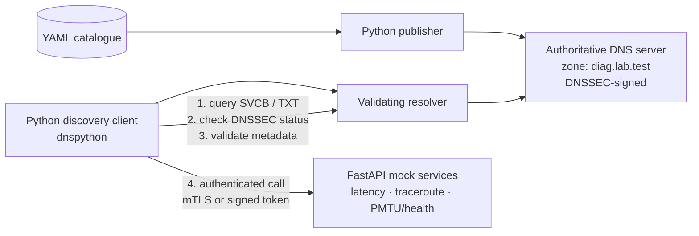

<div align="center">

# 🛰️ DiagMesh

### DNS-Based Discovery of Diagnostic Services

*Find diagnostic services through DNS, not hardcoded endpoints.*

**AIORI Hackathon 3** · **PS-033** · Cloud Computing & IoT · Team **DNSync** · `A3-PS033-TC564`

</div>

---

## 📑 Table of Contents

- [Overview](#-overview)
- [Architecture](#-architecture)
- [Approach](#-approach)
- [Repository Structure](#-repository-structure)
- [Getting Started](#-getting-started)
- [Testing](#-testing)
- [Scope and Limitations](#-scope-and-limitations)
- [Demo and Videos](#-demo-and-videos)
- [Team](#-team)
- [References](#-references)

---

## 🔎 Overview

DiagMesh is a proposed prototype for discovering diagnostic services through DNS rather than relying on hardcoded or manually configured service endpoints. It publishes endpoint information and service metadata as DNS service records, and uses DNSSEC validation to check the integrity and authenticity of that data.

The design deliberately separates three concerns:

| Concern | Responsibility | Handled by |
|---|---|---|
| **Service discovery** | Finding where a service lives and what it offers | SVCB + TXT records, Python discovery client |
| **DNS data integrity** | Confirming DNS answers are authentic and unmodified | DNSSEC signing + validating resolver |
| **Service authorization** | Deciding whether a client may use the service | The diagnostic service itself (mTLS / signed bearer token) |

---

## 🧭 Architecture



**Flow in short:** the catalogue is the source of truth → the publisher generates records → the zone is signed → the client asks the validating resolver → checks validation status and metadata → resolves the endpoint → calls the service with independently provisioned credentials.

---

## 🛠️ Approach

| Component | Description |
|---|---|
| **DNS infrastructure** | An authoritative DNS server hosts the `diag.lab.test` test zone and publishes the service-discovery records. |
| **DNSSEC integrity** | The zone is DNSSEC-signed and a validating resolver verifies the data. The lab uses a **local trust anchor** and does not depend on a public parent-zone delegation. |
| **Service records** | **SVCB** records describe the service target and connection parameters. **TXT** records carry capability, version, and authentication hints. |
| **Metadata publication** | A Python publisher reads a **YAML catalogue** (the source of truth) and generates the DNS records. |
| **Discovery client** | A `dnspython`-based client queries the validating resolver, checks DNSSEC validation status and metadata structure, then resolves the endpoint. |
| **Diagnostic services** | FastAPI mock services for **latency**, **traceroute**, and **Path-MTU / health**. Measurements are simulated for the controlled prototype. |
| **Independent authorization** | Calls use an out-of-band mechanism such as **mutual TLS (mTLS)** or a **signed bearer token**. Credentials are never published in DNS. |
| **Testing** | Positive and negative tests covering valid discovery, DNSSEC failures, missing validation status, malformed metadata, invalid credentials, and unavailable services. |

---

## 📁 Repository Structure

```text
.
├── src/diagmesh/
│   ├── client/       # DNS-based diagnostic service discovery client
│   ├── publisher/    # YAML-driven publisher for discovery DNS records
│   ├── resolver/     # Validating resolver configuration and related files
│   ├── security/     # Trust configuration and security-related files
│   ├── services/     # FastAPI mocks: latency, traceroute, Path-MTU/health
│   ├── tests/        # Tests: discovery, integrity, metadata, authorization, availability
│   └── zone/         # Authoritative zone config, records, DNSSEC-related files
├── .env.example           # Example environment variables (no real credentials)
├── docker-compose.yml     # Docker Compose setup for the lab components
├── requirements.txt       # Python dependencies
├── requirements-lock.txt  # Locked dependency versions, if maintained
├── Makefile               # Common development, test, and demo commands
└── README.md              # You are here
```

---

## 🚀 Getting Started

> Replace the commands below with the exact targets from your `Makefile` once finalised.

```bash
# 1. Clone the repository
git clone <your-repo-url>
cd <your-repo-folder>

# 2. Configure environment (example file contains no real credentials)
cp .env.example .env

# 3. Install Python dependencies
pip install -r requirements.txt

# 4. Start the lab components (DNS server, resolver, services)
docker compose up -d

# 5. See available shortcuts
make help
```

---

## ✅ Testing

The test suite is designed to check both the happy path and the failure handling:

- ✔️ Valid discovery of a diagnostic service
- ❌ DNSSEC validation failure
- ❌ Missing DNSSEC validation status
- ❌ Malformed service metadata
- ❌ Invalid or missing credentials
- ❌ Unavailable service

```bash
make test    # or: pytest src/diagmesh/tests
```

---

## ⚠️ Scope and Limitations

- **Controlled lab only.** DiagMesh uses a single test zone, `diag.lab.test`, and three simulated diagnostic services. It is **not** an Internet-wide service registry.
- **DNSSEC ≠ trust or authorization.** DNSSEC provides integrity and authentication of DNS data. It does not prove a discovered service is trustworthy and does not authorize a client to use it. Authorization is enforced separately through mTLS or signed bearer tokens provisioned out of band.
- **Mock services.** Diagnostic outputs are simulated and must not be presented as measurements from real network infrastructure.
- **No unproven performance claims.** Architectural benefits and failure handling must be demonstrated through testing; no performance improvement is claimed without measured results.

---

## 🎬 Demo and Videos

| | Link |
|---|---|
| Intro Video | (https://youtu.be/Q2KIZL3n2Ds) |
| Live Demo | https://aiori-ps033-frontend.onrender.com/ |
| Team Introduction Video | https://youtube.com/shorts/oTi7_iamfoA?si=58JT_KmEVqrjsGlv|

---

## 👥 Team

**Team DNSync** · Team Code `A3-PS033-TC564`

| Name | Contact |
|---|---|
| Aarushi Javale | aarushi.javale@mitwpu.edu.in |
| Anushka Wadekar | 1262260790.a@mitwpu.edu.in |

---

## 📚 References

1. Mockapetris, P. (1987). *Domain Names — Concepts and Facilities* (RFC 1034). IETF. <https://www.rfc-editor.org/rfc/rfc1034.html>
2. Mockapetris, P. (1987). *Domain Names — Implementation and Specification* (RFC 1035). IETF. <https://www.rfc-editor.org/rfc/rfc1035.html>
3. Arends, R., et al. (2005). *DNS Security Introduction and Requirements* (RFC 4033). IETF. <https://www.rfc-editor.org/rfc/rfc4033.html>
4. Arends, R., et al. (2005). *Resource Records for the DNS Security Extensions* (RFC 4034). IETF. <https://www.rfc-editor.org/rfc/rfc4034.html>
5. Arends, R., et al. (2005). *Protocol Modifications for the DNS Security Extensions* (RFC 4035). IETF. <https://www.rfc-editor.org/rfc/rfc4035.html>
6. Schwartz, B., et al. (2023). *Service Binding and Parameter Specification via the DNS (SVCB and HTTPS Resource Records)* (RFC 9460). IETF. <https://www.rfc-editor.org/rfc/rfc9460.html>
7. Rescorla, E. (2018). *The Transport Layer Security (TLS) Protocol Version 1.3* (RFC 8446). IETF. <https://www.rfc-editor.org/rfc/rfc8446.html>
8. Jones, M., and Hardt, D. (2012). *The OAuth 2.0 Authorization Framework: Bearer Token Usage* (RFC 6750). IETF. <https://www.rfc-editor.org/rfc/rfc6750.html>
9. Jones, M., Bradley, J., and Sakimura, N. (2015). *JSON Web Token (JWT)* (RFC 7519). IETF. <https://www.rfc-editor.org/rfc/rfc7519.html>
10. AIORI Hackathon 3. *PS-033: DNS-Based Discovery of Diagnostic Services.* Problem statement, Cloud Computing & IoT category.
11. DNS-AID. *DNS-Based Authentication of Named Entities / DNS-AID Internet-Draft.* Internet-Draft; exact revision to be pinned and verified before claiming conformance.
